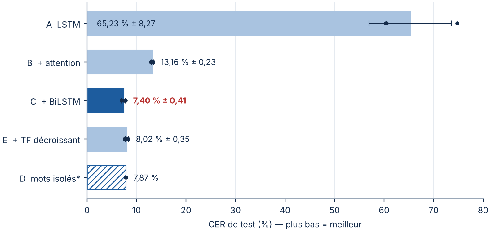
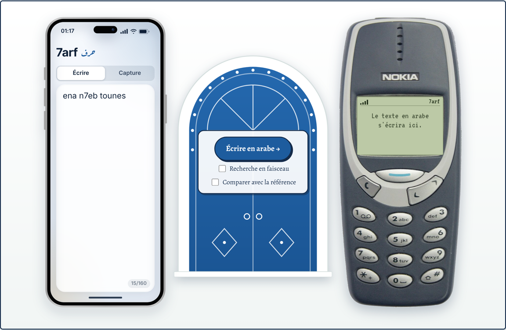

# 7arf — Lire l'Arabizi tunisien en écriture arabe


**7arf** (حرف, « lettre ») transforme un message écrit en **Arabizi tunisien** (lettres latines + chiffres) en **écriture arabe**. Le modèle est un **Encodeur–Décodeur LSTM avec attention de Bahdanau**, écrit et entraîné **from scratch en PyTorch**.

> Projet du cours de **NLP** — Master AIDA, Université Paris Dauphine-PSL — encadré par **Pr. Tarifa Amal**.

---

## Date du projet

**Novembre 2026**

---

## La problématique

J'écris souvent à ma mère en **Arabizi tunisien**, comme beaucoup de Tunisiens sur WhatsApp ou Messenger. Maman comprend très bien le **français** et l'**arabe**, mais pas l'Arabizi : ce sont surtout **les chiffres** qui la perdent. Pour elle, un `3` ou un `7` reste un nombre, pas une lettre.

| Message envoyé (Arabizi) | Ce que maman peut lire (arabe) |
|---|---|
| `3andi 5ouya w o5ti` | عندي خويا و اختي |
| `ena n7eb tounes` | انا نحبّ تونس |
| `9adech soum hedha` | قدّاش سوم هاذا |

*(Sorties réelles du meilleur modèle.)*

---

## Question de recherche

> Un réseau de neurones entraîné à partir de zéro peut-il apprendre à réécrire automatiquement l'Arabizi tunisien en écriture arabe ? Et que changent l'**attention**, le **BiLSTM** et le **teacher forcing** ?

---

## Pourquoi c'est difficile

- **Les chiffres remplacent des lettres arabes** : le 3 note ع, le 7 note ح, le 9 note ق et le 5 note خ.
- **Pas d'orthographe fixe** : `chnowa`, `chnoua`, `chnouwa` désignent le même mot.
- **Mélange de langues** : les mots français doivent être recopiés tels quels.
- **Peu de données annotées** existent.

---

## Les données

| | |
|---|---|
| **Corpus** | TArC — *Tunisian Arabish Corpus* (Gugliotta & Dinarelli, LREC 2020) |
| **Licence** | CC BY-NC-SA 4.0 (usage non commercial) |
| **Origine** | réseaux sociaux, forums, blogs, paroles de rap |
| **Fichier utilisé** | `data/tarc/tarc_annotated_clean.tsv` |
| **Taille** | 4 504 phrases, 38 036 paires de mots Arabizi → arabe |

**Nettoyage.** Le corpus original contient beaucoup de mots grossiers et d'insultes. Je les ai retirés avant l'entraînement, car l'objectif est d'écrire des messages pour ma mère.

**Découpage** (par phrase, sans fuite entre les parties) :

| | Train | Validation | Test |
|---|---:|---:|---:|
| Phrases | 3 605 | 451 | 448 |
| Fenêtres de 6 mots | 6 864 | 918 | 862 |

---

## Le pipeline

```text
Texte Arabizi brut
    ↓
Prétraitement : minuscules, Unicode, pseudonymes → §, "aaaaa" → "aaa"
    ↓
Tokenisation en caractères + vocabulaire (<PAD> <UNK> <SOS> <EOS>)
    ↓
Embedding : chaque caractère devient un vecteur de 64 nombres
    ↓
Encodeur LSTM / BiLSTM : lit l'Arabizi
    ↓
Attention de Bahdanau : à chaque pas, regarde les bons caractères
    ↓
Décodeur LSTM : écrit l'arabe lettre par lettre, jusqu'à <EOS>
    ↓
Évaluation : CER, exact match, BLEU, perplexité
```

**Pourquoi des caractères et pas des mots ?** Au niveau du mot, un mot du test sur quatre n'a jamais été vu pendant l'entraînement. Au niveau du caractère, presque tout est connu : le modèle apprend des **règles** (comme `3` → ع) qu'il applique même à des mots nouveaux.

---

## Les cinq modèles comparés

Chaque modèle ajoute **une seule modification** au précédent : on sait donc d'où vient chaque différence.

| Modèle | Ce qui change | Question | Paramètres |
|---|---|---|---:|
| **A** | LSTM sans attention | un seul vecteur suffit-il ? | 1,85 M |
| **B** | + attention de Bahdanau | l'attention aide-t-elle ? | 2,61 M |
| **C** | + encodeur BiLSTM | lire dans les deux sens aide-t-il ? | 3,83 M |
| **D** | C sur mots isolés | le contexte de phrase compte-t-il ? | 3,83 M |
| **E** | C + teacher forcing de 1 à 0,5 | s'habituer à ses erreurs aide-t-il ? | 3,83 M |

*Paramètres = nombre de poids appris pendant l'entraînement (1,85 M = 1,85 million).*

---

## Résultats

Résultats sur le **test**, moyenne sur 3 entraînements (3 *seeds*).

| Modèle | CER ↓ | Exact match ↑ | BLEU ↑ |
|---|---:|---:|---:|
| A — sans attention | 65,23 % | 15,66 % | 6,39 |
| B — + attention | 13,16 % | 42,69 % | 55,83 |
| **C — + BiLSTM** | **7,40 %** | **54,45 %** | **67,43** |
| E — + teacher forcing décroissant | 8,02 % | 51,24 % | 65,92 |
| D — mots isolés* | 7,87 % | 86,92 % | 62,65 |

\* D est évalué mot par mot : il n'est pas directement comparable aux autres.



**Ce qu'on retient :**

- **L'attention est décisive** : le CER passe de 65 % à 13 %.
- **Le BiLSTM aide encore** : le meilleur modèle, **C**, atteint **7,40 %** de CER, soit plus de 92 % de caractères corrects.
- **Le teacher forcing décroissant n'apporte rien** sur ce corpus.
- **Le modèle retrouve seul l'alphabet des chiffres** : le 3 donne ع, le 7 donne ح et le 9 donne ق, sans que personne ne lui donne la table.

---

## Deux notions expliquées simplement

**La seed.** L'entraînement utilise du hasard (poids de départ, ordre des exemples). La *seed* fixe ce hasard : on peut refaire exactement la même expérience. En entraînant chaque modèle avec 3 seeds, on vérifie qu'un bon résultat n'est pas dû à la chance. Par exemple, le modèle A varie de 60 % à 75 % de CER selon la seed, alors que C reste stable.

**Le beam search.** Le décodage *greedy* prend à chaque pas la lettre la plus probable, mais ne peut jamais corriger une erreur. Le *beam search* garde les 5 meilleures hypothèses en parallèle et choisit le mot le plus probable dans son ensemble. Sur 100 exemples, il fait passer le CER de 11,52 % à 10,28 %, mais il est plus lent.

---

## Bonus : l'application web et l'OCR

Pour que maman puisse vraiment utiliser 7arf, j'ai ajouté une petite application :

- **Écrire** : on tape le message en Arabizi sur un iPhone, et le texte arabe s'affiche sur un Nokia 3310 ;
- **Capture (OCR)** : on dépose une capture d'écran d'une conversation, et Tesseract en lit le texte avant la translittération ;
- **Options** : beam search, comparaison avec le modèle A, et carte d'attention interactive.



---

## Structure du projet

```text
7arf/
├── README.md
├── requirements.txt
├── notebooks/
│   └── 7arf.ipynb          le notebook complet : données, modèles, entraînement, résultats
├── data/tarc/              le corpus TArC nettoyé
├── models/                 les 13 modèles entraînés (best.pt + vocabulaires)
├── results/                tableaux de résultats et figures
├── backend/                serveur Python : charge le modèle et traduit
├── app/                    interface web : HTML, CSS, JavaScript
└── docs/
    ├── 7arf_rapport_scientifique.pdf   rapport 
    ├── 7arf_presentation.pptx          présentation
    └── demo.gif                        animation de démonstration
```

---

## Installation et lancement

Il faut **Python 3.10, 3.11 ou 3.12**. Le guide détaillé, avec le dépannage, est dans [`docs/LOCAL_SETUP.md`](docs/LOCAL_SETUP.md).

### 1. Ouvrir le dossier du projet

Ouvrez le dossier `7arf` dans VS Code, puis un terminal (*Terminal → Nouveau terminal*).

### 2. Créer l'environnement et installer les dépendances

```bash
python -m venv .venv
.\.venv\Scripts\Activate.ps1        # Windows (PowerShell)
# source .venv/bin/activate         # macOS / Linux
pip install -r requirements.txt
```

### 3. Lancer l'application

```bash
python -m backend.server
```

Puis ouvrez dans le navigateur :

```text
http://localhost:8000
```

Le serveur lance à la fois le modèle et l'interface : il n'y a qu'une seule commande. Pour l'OCR, il faut en plus installer **Tesseract**.

### 4. Le notebook

Ouvrez `notebooks/7arf.ipynb` dans **Google Colab** (avec un GPU) et lancez *Exécution → Tout exécuter*. Par défaut, `RUN_TRAINING = False` : le notebook recharge les modèles déjà entraînés au lieu de tout réentraîner (environ 2 h sur GPU).

---

## Ce que ce projet m'a appris

- Comment un texte devient des nombres : normalisation, caractères, identifiants, embeddings.
- Pourquoi un seul vecteur de contexte est un goulot d'étranglement, et comment l'attention le résout.
- L'importance d'un protocole rigoureux : découpage sans fuite, choix du modèle sur la validation, plusieurs seeds.
- Lire les erreurs autant que les scores : beaucoup d'erreurs sont des variantes d'orthographe acceptables.

---

## Limites

- Le corpus est petit, et ses auteurs viennent surtout de Tunis.
- Il n'y a qu'une seule réponse de référence, alors que plusieurs orthographes arabes sont souvent possibles.
- Le modèle ne voit que 6 mots de contexte.
- Les lettres stylisées (`βēšŧ`) et certains mots français restent mal traités.

---

## Améliorations possibles

- Ajouter des données d'autres régions de Tunisie.
- Accepter plusieurs réponses correctes.
- Ajouter un mécanisme pour recopier directement les mots français.
- Comparer avec un modèle Transformer de taille équivalente.

---

## Références

- E. Gugliotta & M. Dinarelli, *TArC: Incrementally and Semi-Automatically Collecting a Tunisian Arabish Corpus*, LREC 2020.
- D. Bahdanau, K. Cho & Y. Bengio, *Neural Machine Translation by Jointly Learning to Align and Translate*, ICLR 2015.
- I. Sutskever, O. Vinyals & Q. V. Le, *Sequence to Sequence Learning with Neural Networks*, NeurIPS 2014.
- S. Hochreiter & J. Schmidhuber, *Long Short-Term Memory*, Neural Computation, 1997.

---

## Licence

Aucun fichier de licence n'est inclus pour le code. Les données TArC restent sous licence **CC BY-NC-SA 4.0** : le projet est réservé à un **usage non commercial**.

---

## Contact

- **GitHub :** https://github.com/arefbakali
- **LinkedIn :** https://www.linkedin.com/in/aref-bak-ali/
- **Email :** aref.bak-ali@dauphine.eu
- **Portfolio :** https://portfolio-aref.vercel.app/

## Auteur

**Aref Bak Ali**  
Master AIDA — Université Paris Dauphine-PSL  
Encadré par **Pr. Tarifa Amal**
